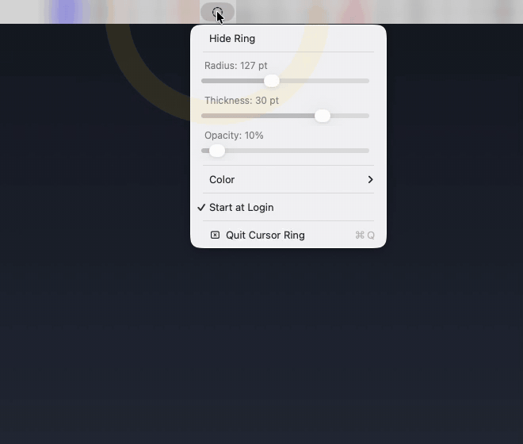

# CursorRing

A tiny macOS menu-bar app that draws a circular band around the mouse cursor at an adjustable radius.


## Why

The idea comes from *Eno*, Gary Hustwit's documentary about Brian Eno, where a ring like this around the mouse pointer caught my eye.

A ring makes the pointer easy to follow:

- **Screen sharing, demos and recordings.** Viewers can see where you're pointing without hunting for a tiny arrow.
- **Large or multiple displays.** You find the cursor at a glance instead of shaking the mouse.
- **Accessibility.** It helps anyone with low vision or who loses track of small pointers.
- **Focus.** A soft halo marks where your attention is on a busy screen.

The ring ignores clicks, so it never gets in the way, and you can tune its size, thickness, opacity and colour (or hide it) from the menu bar.

## Download

Grab `CursorRing.zip` from the [latest release](https://github.com/boyanangelov/cursor-ring/releases/latest), unzip it and move `CursorRing.app` to Applications.

The app isn't signed with an Apple Developer ID, so macOS blocks it the first time. To open it anyway: right-click the app and choose **Open**, or go to **System Settings ▸ Privacy & Security** and click **Open Anyway**. You can also clear the quarantine flag from a terminal:

```sh
xattr -dr com.apple.quarantine /Applications/CursorRing.app
```

## Requirements

- An Apple Silicon Mac (M1 or later) running macOS 11 (Big Sur) or later
- To build from source: the Xcode Command Line Tools (`xcode-select --install`)

## Build & run

```sh
./build.sh
open CursorRing.app
```

Use the menu-bar icon to adjust radius, thickness, opacity and color, or to hide the ring. Changes apply live:



([MP4 version](docs/menu-demo.mp4))

## Start at login

Tick **Start at Login** in the menu-bar menu. It writes a LaunchAgent (`~/Library/LaunchAgents/io.github.boyanangelov.cursorring.plist`) pointing at the running copy of the app, and unticking removes it. The change applies from your next login.

Or install it into `~/Applications` and register it for login in one go:

```sh
./install.sh
```

Installs to `~/Applications` and registers a LaunchAgent (`~/Library/LaunchAgents/io.github.boyanangelov.cursorring.plist`). The script prints the uninstall command.

## License

[MIT](LICENSE)
